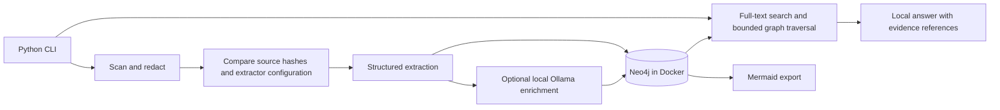

# Architecture

## Graph and evidence

`Workspace` isolates one configuration. `Source` stores redacted content, content hash, synchronization
time, extraction fingerprint, errors, and pending enrichment state. `Entity` represents a component,
library, or infrastructure resource. `Source-[:DECLARES]->Entity` records extraction provenance.

`Entity-[:DEPENDS_ON]->Entity` stores a typed dependency through its `kind` property. Each relationship
contains its supporting source ID, path, line, redacted excerpt, raw-content hash, and certainty.
Multiple source files may independently support the same architectural connection. Exports deduplicate
those connections while retaining the evidence list. Dependency direction runs from consumer to dependency.

All graph operations are scoped by workspace. Entity keys additionally capture repository, explicit
configuration context, or a complete AWS ARN as appropriate. Cross-repository local npm resolution
requires a unique matching package manifest; resolved relationships are reconciled after each sync.

## Synchronization

1. Acquire a per-user filesystem lock for this workspace and Neo4j target.
2. Scan all roots before mutating the graph. Missing or unreadable roots abort the run.
3. Compare hashes, repository identity, component name, extractor version, and model configuration.
4. Extract changed files; enrich serially when the local model is available.
5. Replace each source's evidence atomically. Keep previous evidence on extraction failure and mark it stale.
6. Delete evidence for removed or newly excluded files, reconcile local packages, and prune unsupported entities.
7. Record the run time and report updates, deletions, unchanged files, failures, and pending enrichment.

Transactions are per source, not per entire workspace. A terminated run can contain successfully updated
files alongside older files; the next sync safely resumes using persisted hashes. The last completed sync
time is shown on query/export commands. Do not run multiple machines against one workspace: the MVP lock
coordinates processes on one Linux/WSL host only.

## GraphRAG

The query pipeline creates escaped search terms, retrieves matching source records from a full-text
index, expands dependency paths in both directions up to three hops toward matching resources, and builds
bounded evidence context. Library hubs are excluded from traversal. Source excerpts center on matching
lines instead of assuming relevant content appears at the start of the file. Retrieval interleaves
the highest-ranked sources per repository so a large repository cannot consume the entire result set.
Documentation hyperlinks
and manifest metadata URLs do not create runtime connections.
The model receives explicit evidence IDs. Output with missing or unknown citation IDs is replaced by the
retrieved evidence. This checks reference integrity; it does not prove semantic entailment of every claim.

No arbitrary model-generated Cypher is executed. No vector database or Microsoft GraphRAG dependency is
required: retrieval combines text search with graph traversal. Local model output is untrusted, validated
against source lines, and stored as inferred evidence.

## Current boundaries

- Static source analysis cannot prove the deployed architecture or runtime failure impact.
- URL parsing and template references cover common patterns, not every language construct or IaC provider.
- Model enrichment processes a bounded prefix of each source file; the structured extractors inspect the full eligible file.
- Questions are independent; multi-turn conversational state is deferred.
- Exact package matching is the first cross-repository resolver; ambiguous matches remain unresolved.
- There are no cloud credentials, external model calls, watcher, frontend, or MCP server in the MVP.

## Architectural reconstruction

A separate `Architecture` record per repository persists the architectural projection and synthesis
fingerprint. Its JSON payload contains executable units, resource relationships, model summaries, and
supporting references; it does not replace the detailed entity graph. `sync` reconstructs changed
repositories and reconciles proven local-package connections across repositories. Model responses
use a constrained JSON schema and are validated against component IDs and source references.

Targeted passages are selected throughout source files. Client construction, literal HTTP calls,
explicit Compose dependencies, Docker definitions, and supported template references supply stronger
evidence than package presence. Unknown resource identities remain separate. Nested executable
manifests can identify additional units; test/documentation scripts are excluded from unit discovery.

The default export is a layered solution diagram. Infrastructure exports preserve deployment
containers; solution exports contract those containers into their owning application and preserve
their dependencies. Both are logical repository-derived views, not verified production topology.
Fully cached synchronization makes no model calls. Invalid or unavailable synthesis retains
structured discoveries and marks reused summaries stale; status reports incomplete repositories.
